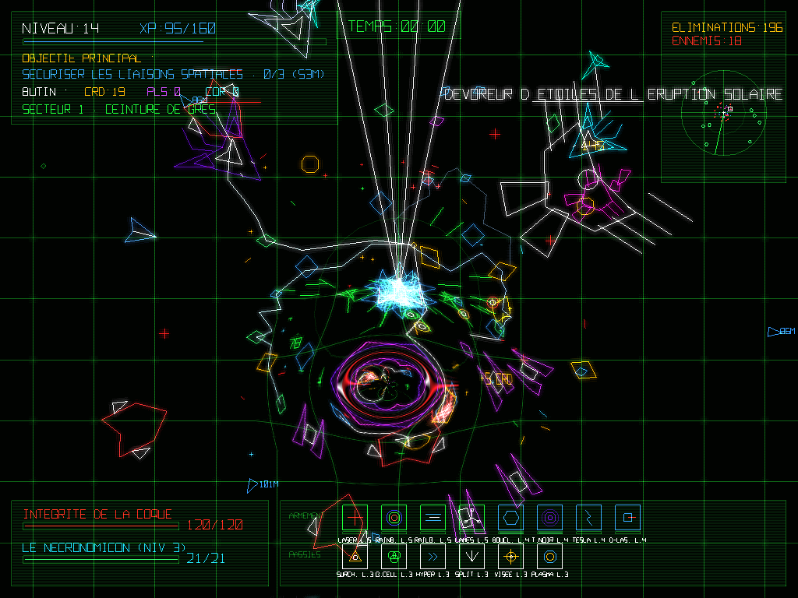
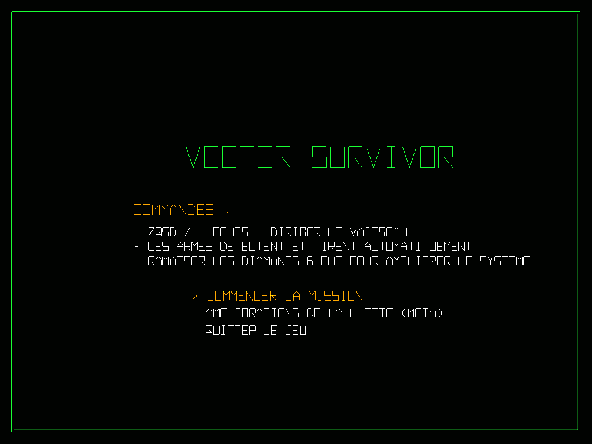
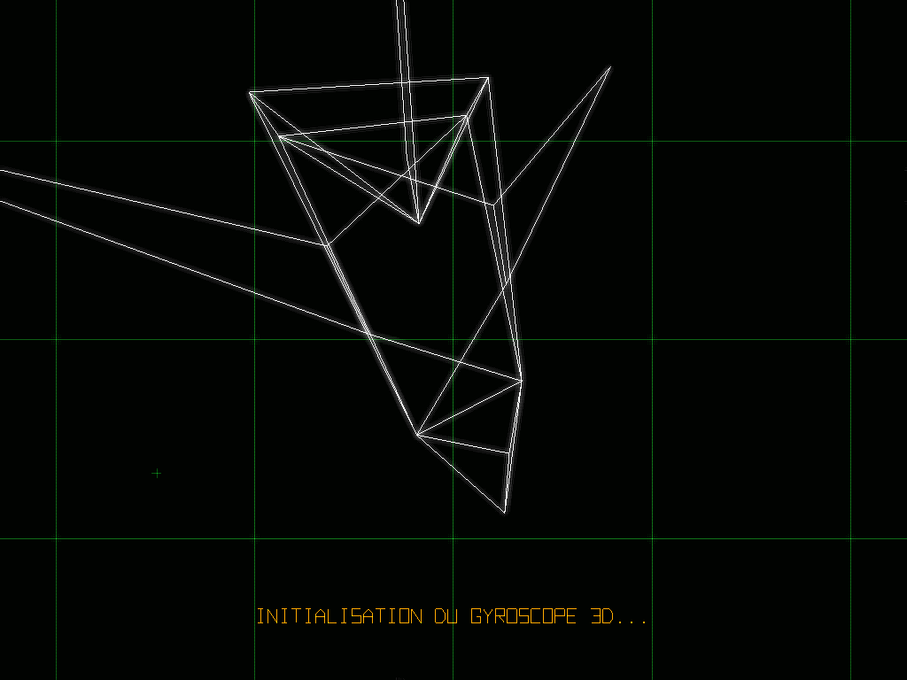
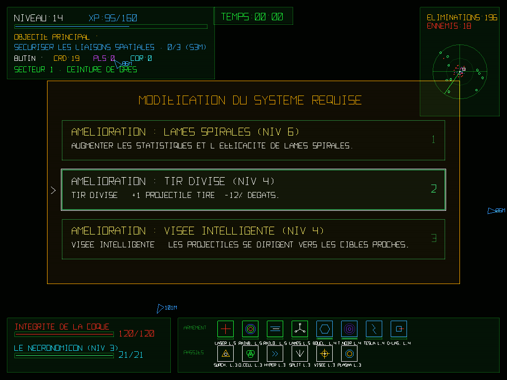
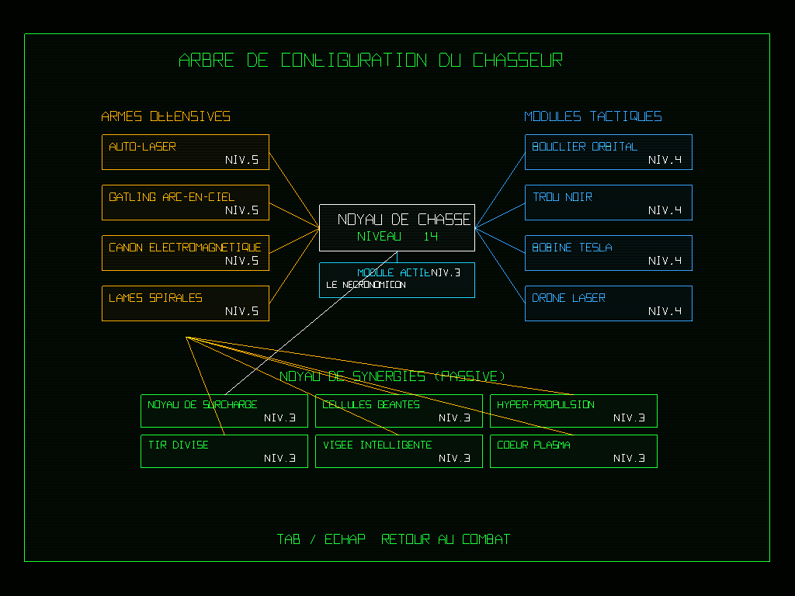
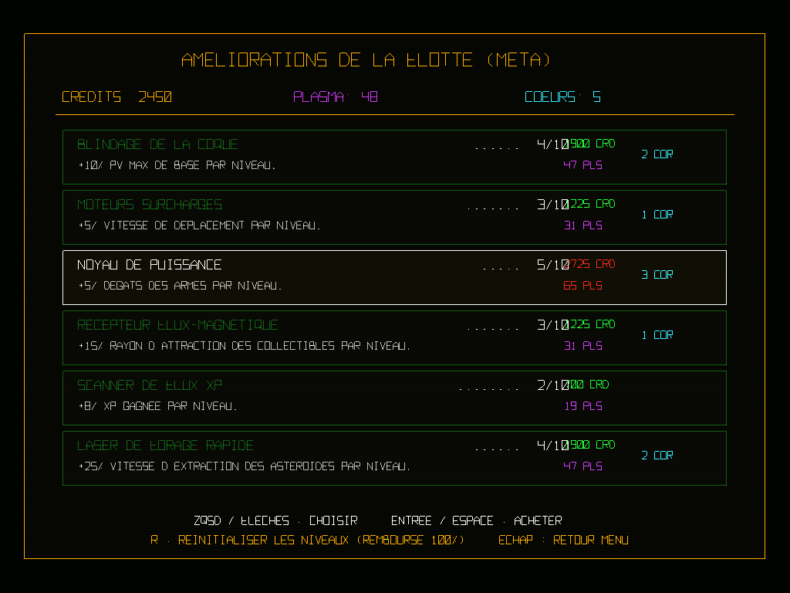
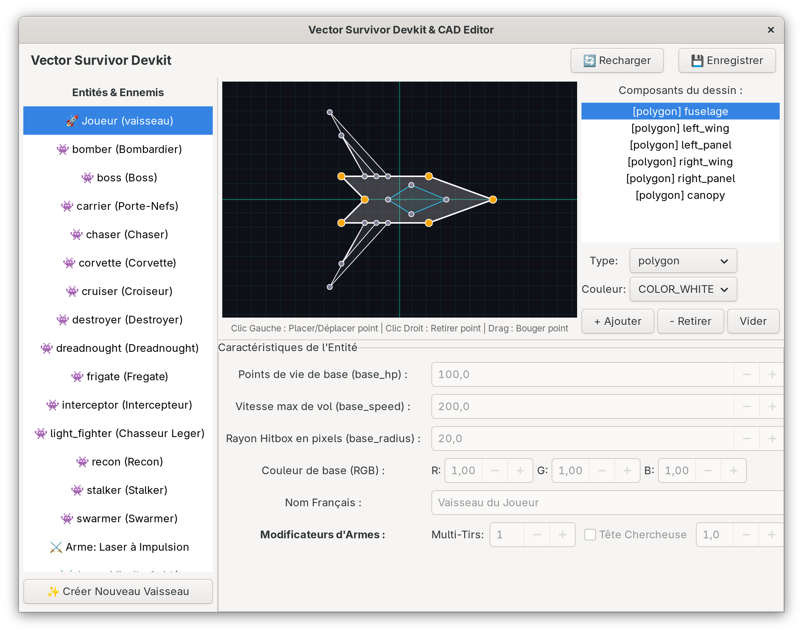

<div align="center">

# ☄️ ASTEROGUE — *Vector Survivor*

**Un Rogue-Lite Spatial & Bullet-Heaven en rendu vectoriel néon OpenGL 3.3 avec post-processing CRT**

[](https://www.python.org/)
[](https://pyga.me/)
[](https://moderngl.readthedocs.io/)
[](https://www.gtk.org/)

<br/>



*Affrontez des essaims cosmiques, des escadrons en formation Boids et des Boss colossaux dans un univers purement vectoriel.*

</div>

---

## 📖 Présentation

**ASTEROGUE** (*Vector Survivor*) est un jeu d'action **Rogue-Lite / Bullet-Heaven** développé en Python avec **Pygame** et **ModernGL**. Il fusionne :
- L'esthétique **vectorielle rétro-futuriste** des bornes d'arcade classiques (*Asteroids*, *Tempest*) sublimée par un pipeline de shaders GLSL (bloom néon, distorsion gravitationnelle, aberration chromatique RGB, scanlines et vignettage CRT).
- La frénésie d'armement automatique d'un **Vampire Survivors**.
- Un système profond de **synergies de projectiles** inspiré de *The Binding of Isaac* (*Brimstone*, *Tech X*, *Mom's Knife*, *Sacred Heart*, *Tiny Planet*, *Lump of Coal*...).
- Des **objectifs tactiques d'extraction** inspirés de *Deep Rock Galactic* (forage de cristaux de plasma, récolte d'œufs extraterrestres, sécurisation de balises de transmission et évacuation par capsule).
- Un **éditeur CAO / Devkit complet en GTK3 & Cairo** permettant de modéliser les polygones des vaisseaux et d'ajuster l'équilibrage en temps réel.

---

## 📸 Galerie & Captures d'écran

### 🎮 Interface & Cinématique 3D
| Menu Principal CRT | Initialisation Gyroscopique 3D |
| :---: | :---: |
|  |  |
| *Rendu vectoriel net sur écran cathodique simulé* | *Projection perspective 3D fil de fer au lancement de mission* |

### ⚔️ Combat Spatial & Évolution en Mission
| Combat & Synergies Néon | Sélection d'Amélioration (Level-Up) |
| :---: | :---: |
|  |  |
| *Lasers, Gatling Arc-en-Ciel, Trou Noir (lentille gravitationnelle) & Boss* | *Déverrouillage d'armes, drones, modules actifs et évolutions* |

### 🛸 Arbre de Configuration & Méta-Progression
| Arbre de Synergies du Chasseur (`TAB`) | Améliorations Permanentes de la Flotte |
| :---: | :---: |
|  |  |
| *Visualisation temps réel des connexions Armes ↔ Passifs ↔ Drones* | *Boutique persistante (Crédits, Plasma, Cœurs d'Astraea)* |

### 🛠️ Vector Survivor Devkit & CAD Editor (`devkit_editor.py`)
<div align="center">



*Outil interne de conception CAO vectorielle (polygones, lignes, cercles), prévisualisation animée des tirs et édition directe de `data/shapes.json` et `data/enemy_config.json`.*

</div>

---

## ✨ Fonctionnalités & Analyse Technique

### 🖥️ 1. Moteur Graphique Vectoriel & Pipeline GLSL (3 Passes)
Contrairement aux moteurs 2D basés sur des sprites, **100 % du rendu d'ASTEROGUE est géométrique** (segments, polygones, cercles et police vectorielle maison `VECTOR_FONT`) :
- **Passe 1 (World FBO)** : Rendu de la scène spatiale dans un *Framebuffer* hors-écran avec mélange additif (`SRC_ALPHA, ONE`), gestion de la caméra, rotation dynamique et zoom adaptatif selon la densité de menaces.
- **Passe 2 (Post-Processing Shader GLSL 330)** :
  - **Bloom / Glow Néon** : Flou gaussien pondéré 5×5 amplifiant l'éclat des vecteurs lumineux.
  - **Lentille Gravitationnelle** : Déformation spatiale des coordonnées UV autour des Trous Noirs et Vortex actifs (`u_blackhole_pos`, `u_blackhole_radius`).
  - **Glitch & Split RGB** : Décalage des canaux Rouge/Bleu et bruit horizontal lors des impacts ou sauts hyperspatiaux.
  - **Simulation CRT** : Balayage *scanlines*, vignettage doux, distorsion d'onde dans les menus et rémanence phosphore vert.
- **Passe 3 (HUD Direct)** : Rendu de l'interface tête haute directement sur l'écran après le flou pour garantir une lisibilité parfaite des textes vectoriels et du radar.

### 🔫 2. Arsenal Complet & Synergies (*Isaac-like*)
Le vaisseau peut équiper jusqu'à **4 Armes Principales**, **4 Drones Tactiques**, **1 Module Actif** et **6 Passifs de Synergie** :

- **14 Armes Principales** (jusqu'au Niv. 8 + 7 modificateurs d'évolution par arme jusqu'au Niv. 10) :
  - *Auto-Laser*, *Canon Électromagnétique (Railgun)*, *Onde de Choc*, *Lance-Flammes*, *Grenade Vortex*, *Lames Spirales*, *Missile Tête Chercheuse*, *Coup de Faux*, *Brimstone* (faisceau sanglant continu), *Tech X* (anneaux laser), *Couteau de Maman*, *Gatling Arc-en-Ciel*, *Lanceur Météore*, *Éclair de Néon*.
- **9 Drones & Accessoires Autonomes** (physique orbitale avec attraction ennemie, séparation et laisse élastique) :
  - *Bouclier Orbital*, *Drone Laser*, *Drone Roquette*, *Trou Noir*, *Bobine Tesla*, *Drone de Soin*, *Robo-Baby*, *Drone Infestateur*, *Drone Sec* (bloque les projectiles ennemis et déclenche des ondes de choc).
- **4 Modules Actifs** (`E`) :
  - *Propulsion Hyperspatiale* (dash + invulnérabilité), *D6 / Dés du Destin* (relance des choix de level-up), *Le Nécronomicon* (dégâts massifs de zone chargés aux éliminations), *Livre des Ombres* (bouclier d'invulnérabilité).
- **19 Améliorations Passives & Modificateurs** :
  - *Cellules Géantes*, *Hyper-Propulsion*, *Tir Divisé*, *Visée Intelligente*, *Matrice Rebondissante*, *Foreuse de Blindage*, *Obus Shrapnel*, *Planète Minuscule*, *Charbon Actif*, *Cœur Sacré*, *Cœur Plasma*, etc.
  - **Cosmétique Dynamique** : L'apparence géométrique du vaisseau joueur évolue visuellement selon les équipements (canons rotatifs RGB, lame frontale, blindage nano, halo doré, propulseur central).

### 🌌 3. Secteurs, Objectifs DRG & Événements Spatiaux
- **3 Secteurs Progressifs** : *Ceinture de Grès* (Secteur 1), *Nébuleuse de Plasma* (Secteur 2), *Abîme Stellaire* (Secteur 3) avec parallaxe stellaire à 3 couches et corps célestes géants.
- **3 Types de Missions Dynamiques** :
  1. **Collecte de Cristaux de Plasma** (35 unités).
  2. **Extraction d'Œufs Extraterrestres** gardés par des escouades d'élite.
  3. **Sécurisation de Balises de Liaison** (défense de zone avec impulsion EMP finale).
  - Une fois l'objectif accompli, la **Capsule d'Évacuation (`EVAC`)** se déploie pour passer au secteur suivant ou remporter la victoire.
- **Forage d'Astéroïdes Fracturables** : 4 catégories d'astéroïdes (*Normal*, *Or/Crédits*, *Plasma*, *Cœur d'Astraea*) qui se scindent physiquement en morceaux plus petits lorsqu'ils sont forés ou détruits.
- **6 Événements Cosmiques Aléatoires** (Architecture *State Pattern*) :
  - *Champ d'Astéroïdes*, *Essaim de la Ruche*, *Tempête Solaire* (cadence de tir affectée & arcs électriques), *Orage Magnétique*, *Puits de Gravité* (singularité attractive), *Tourbillon de Gravité* (rotation progressive de la caméra).

### 👾 4. Bestiaire & Intelligence Artificielle (Flocking Boids)
- **Créatures Cosmiques avec Préfixes Procéduraux** : *Swarmer*, *Chaser*, *Stalker* dotés de 14 préfixes élémentaires (*du Néant*, *Quantique*, *Solaire*, *Buggé*, *Abyssal*...) modifiant leurs couleurs, PV, vitesse, taille et dégâts.
- **Flottes de Vaisseaux & Escadrons Boids** : *Chasseur Léger*, *Intercepteur*, *Bombardier*, *Frégate*, *Corvette*, *Croiseur*, *Destroyer*, *Dreadnought*, *Recon*, *Porte-Nefs (Carrier)*. Les escadrons volent en formation coordonnée grâce aux lois de **Séparation, Alignement et Cohésion**.
- **Boss Colossaux** : Apparaissent toutes les 2 minutes avec des patterns de tir multi-phases (spirales rotatives, salves annulaires de 20 lasers, barrages de missiles autoguidés).

---

## 🕹️ Commandes en Jeu

| Touche / Action | Effet |
| :--- | :--- |
| **`Z Q S D`** / **`W A S D`** / **Flèches** | Diriger le vaisseau (support natif AZERTY & QWERTY) |
| **Tir Automatique** | Les armes et drones ciblent et tirent automatiquement |
| **`E`** | Activer le Module Actif équipé (ou relancer avec le *D6* au Level-Up) |
| **`TAB`** | Ouvrir / Fermer l'**Arbre de Configuration & Synergies** |
| **`1`**, **`2`**, **`3`** / **Souris** / **`Entrée`** | Choisir une amélioration lors d'une montée de niveau |
| **Molette Souris** ou **`O`** / **`P`** | Ajuster le niveau de zoom manuel de la caméra |
| **`F3`** ou **`Shift + D`** | Ouvrir la **Console de Débogage / Codes de Triche** |
| **`R`** *(dans le menu Méta)* | Réinitialiser les améliorations permanentes (remboursement 100 %) |

---

## 🚀 Installation & Lancement

### Prérequis Système
- **Python 3.10+**
- Carte graphique compatible **OpenGL 3.3 Core Profile**
- *(Optionnel, pour l'éditeur CAO `devkit_editor.py`)* : **GTK 3**, **PyGObject** (`python-gobject`) et **PyCairo** (`python-cairo`).

### 1. Cloner le dépôt
```bash
git clone https://github.com/vedix95/ASTEROGUE.git
cd ASTEROGUE
```

### 2. Créer un environnement virtuel et installer les dépendances
```bash
python3 -m venv .venv
source .venv/bin/activate
pip install -r requirements.txt
```

> **Note sous Arch Linux / CachyOS** :
> Si vous souhaitez utiliser l'éditeur CAO (`devkit_editor.py`), assurez-vous que `gtk3` et `python-gobject` sont installés :
> ```bash
> sudo pacman -S gtk3 python-gobject python-cairo
> ```

### 3. Lancer le jeu
```bash
python main.py
```

### 4. Lancer l'éditeur de vaisseaux & entités (Devkit CAD)
```bash
python devkit_editor.py
```

---

## 📁 Architecture du Projet

```text
ASTEROGUE/
├── main.py                        # Boucle principale, moteur OpenGL/FBO, états, événements spatiaux & HUD
├── config.py                      # Constantes globales (résolution, FPS, palette néon, courbe d'XP)
├── devkit_editor.py               # Éditeur CAO GTK3/Cairo pour vaisseaux, formes et équilibrage JSON
├── requirements.txt               # Dépendances Python (pygame-ce, moderngl, numpy, Pillow, reportlab)
├── data/
│   ├── enemy_config.json          # Templates statistiques des ennemis, préfixes et modificateurs d'armes
│   └── shapes.json                # Géométrie vectorielle (polygones, lignes, cercles) du joueur et des ennemis
├── entities/
│   ├── player.py                  # Physique du vaisseau joueur, stats, XP, iframes et rendu
│   ├── enemy.py                   # Entités ennemies, IA de poursuite et comportement d'escadron (Boids)
│   ├── enemy_config.py            # Chargeur JSON et application des modificateurs de préfixes
│   ├── projectile.py              # Physique et rendu de tous les types de projectiles (lasers, vortex, lames...)
│   ├── item.py                    # Collectibles magnétiques (XP, crédits, plasma, cœurs, bombes, soin)
│   └── shapes.py                  # Rendu géométrique dynamique du vaisseau joueur et des classes ennemies
├── systems/
│   ├── shaders.py                 # Shaders GLSL 330 (Vertex/Fragment lignes, Bloom, Lensing, Glitch, CRT)
│   ├── weapon.py                  # Les 14 armes principales, les 9 drones autonomes et leur progression
│   ├── upgrade.py                 # Pool d'améliorations, déblocages, modules actifs et calcul des synergies
│   └── camera.py                  # Caméra fluide avec interpolation (lerp)
├── utils/
│   └── drawing.py                 # Batching GPU de lignes (LineBatch), grille infinie et police VECTOR_FONT
├── scripts/
│   ├── generate_catalog_pdf.py    # Générateur ReportLab du manuel tactique complet en PDF
│   ├── generate_synergies_pdf.py  # Générateur PDF de la matrice des synergies
│   └── generate_pdf.py            # Générateur PDF de documentation technique
└── screenshots/                   # Captures d'écran OpenGL et Devkit du projet
```

---

## 📄 Génération des Manuels Tactiques (PDF)

Le dépôt inclut des scripts basés sur **ReportLab** permettant de générer automatiquement la documentation tactique du jeu au format PDF :
```bash
python scripts/generate_catalog_pdf.py
python scripts/generate_synergies_pdf.py
```

---

<div align="center">
  <i>Développé avec passion par <b><a href="https://github.com/vedix95">vedix95</a></b> — Bon vol dans l'Abîme Vectoriel ! 🚀</i>
</div>
